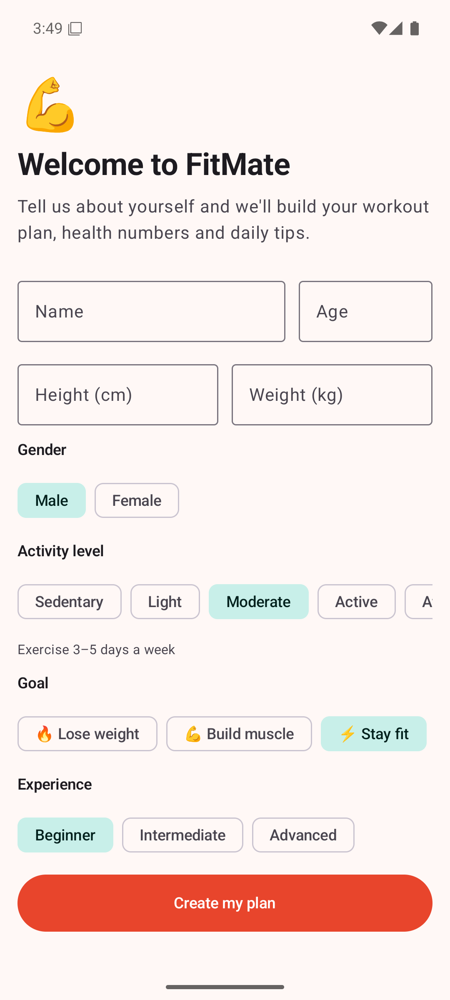
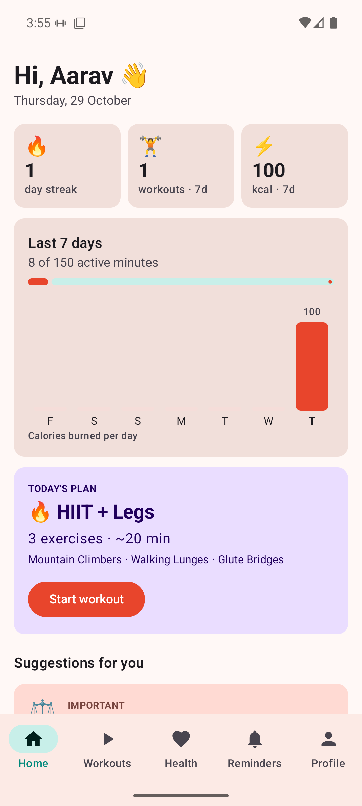
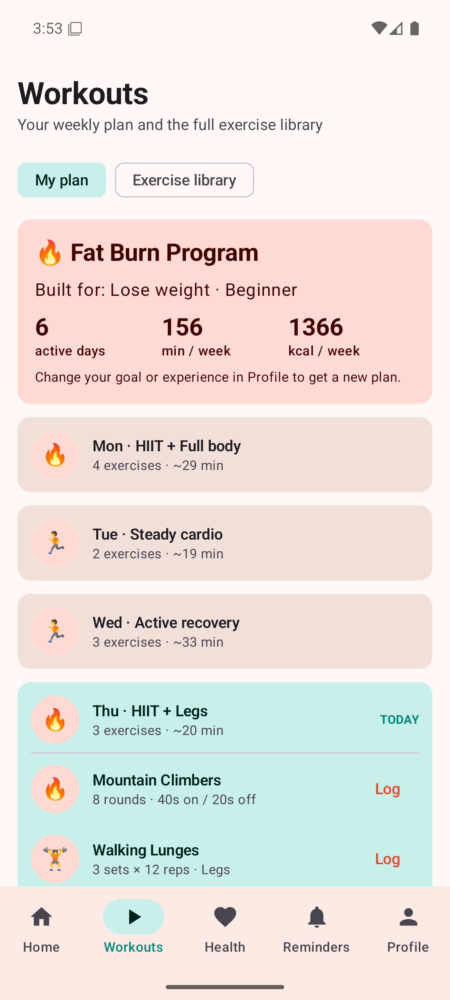
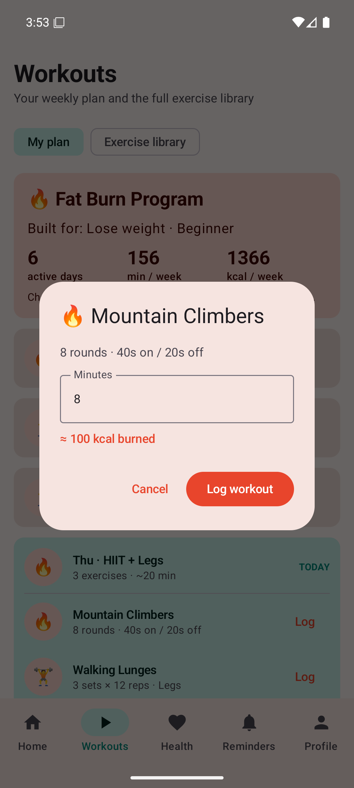
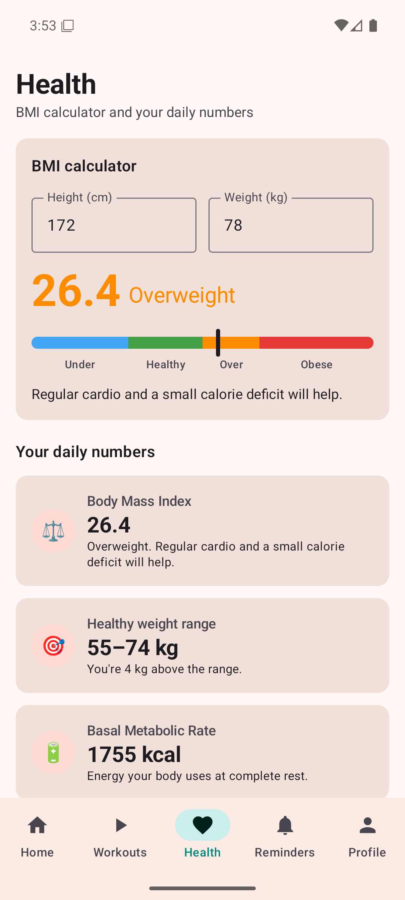
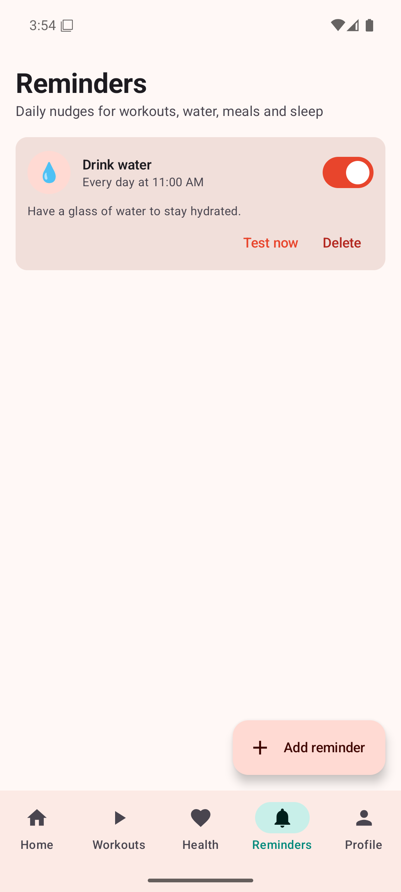
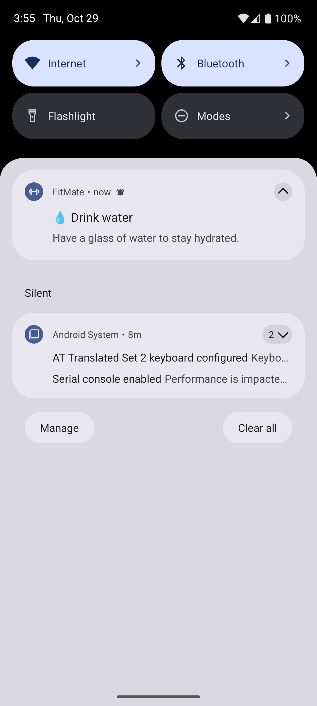
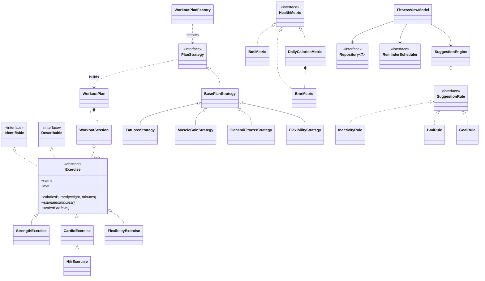

# FitMate — Fitness Tracker & Coach (OOP Project)

FitMate is a fitness app built twice, natively, with **the same object-oriented design**:

| Platform | Language | UI | Folder |
|---|---|---|---|
| Android | Kotlin | Jetpack Compose (Material 3) | [`android/`](android) |
| iOS | Swift | SwiftUI | [`ios/`](ios) |

The class names match across the two apps (`Exercise`, `UserProfile`, `PlanStrategy`, `SuggestionEngine`, …). That makes it easy to show the same OOP idea in both languages side by side.

## Features

- **Onboarding & profile**: name, age, height, weight, gender, activity level, goal and experience level. Invalid values are rejected by the model itself.
- **Personal workout planner**: a 7-day plan generated from your goal (Fat Burn, Push/Pull/Legs, Balanced, Mobility & Yoga) and scaled to your level.
- **Exercise library**: 23 exercises in 4 categories (Strength, Cardio, HIIT, Flexibility), each with its own calorie formula.
- **Workout tracker**: log a workout, see calories burned, a day streak, a 7-day bar chart and progress toward the WHO's 150 active minutes a week.
- **BMI calculator & health numbers**: BMI with a colour gauge, healthy weight range, BMR, daily calorie target, protein and water intake.
- **Smart suggestions**: a rule engine that gives tips based on your BMI, goal, inactivity, overtraining, weekly target, hydration and age.
- **Reminders**: daily local notifications for workouts, water, meals, stretching and sleep, plus a "Test now" button for demos.

## Screenshots (Android emulator)

| Onboarding | Home | Workouts | Log workout |
|---|---|---|---|
|  |  |  |  |

| Health / BMI | Reminders | Notification |
|---|---|---|
|  |  |  |

---

## Where each OOP concept is used

| Concept | Kotlin (Android) | Swift (iOS) |
|---|---|---|
| **Classes & objects** | `UserProfile`, `WorkoutPlan`, `WorkoutSession`, `SuggestionEngine` | same classes |
| **Encapsulation** | [`UserProfile.kt`](android/app/src/main/java/com/fitmate/app/model/UserProfile.kt): validating setters with `require(...)`. `FitnessViewModel` exposes state with `private set` | [`UserProfile.swift`](ios/FitMate/Models/UserProfile.swift): `private(set)` properties + throwing `setWeight(_:)` etc. `FitnessStore` uses `@Published private(set)` |
| **Abstraction** | `abstract class Exercise`, `interface HealthMetric`, `interface ReminderScheduler` | `class Exercise` with abstract members, `protocol HealthMetric`, `protocol NotificationScheduler` |
| **Inheritance** | `Exercise → StrengthExercise / CardioExercise / FlexibilityExercise`. `BasePlanStrategy → FatLossStrategy …`. `ReminderReceiver : BroadcastReceiver` | same hierarchy. `NotificationDelegate : NSObject` |
| **Multi-level inheritance** | `Exercise → CardioExercise → HiitExercise` | same |
| **Method overriding (runtime polymorphism)** | `HiitExercise.caloriesBurned()` calls `super` and adds a 15 % afterburn bonus. Every subclass overrides `estimatedMinutes()`, `subtitle`, `scaledFor()` | same, with `override` |
| **Polymorphism via interfaces** | `DescribableRow` draws an `Exercise`, `WorkoutSession`, `WorkoutLog`, `Reminder` or `Suggestion`. The Health screen loops over `List<HealthMetric>` | `DescribableRow` with `any Describable`. Health screen loops over `[any HealthMetric]` |
| **Interfaces / protocols** | `Identifiable`, `Describable`, `Repository<T>`, `JsonMapper<T>`, `PlanStrategy`, `SuggestionRule`, `Comparable<Suggestion>` | `Describable`, `Repository<Item>`, `PlanStrategy`, `SuggestionRule`, `Comparable` |
| **Default interface methods** | `HealthMetric.formatted()` has a body | protocol extension on `HealthMetric` |
| **Composition ("has-a")** | `WorkoutPlan` has 7 `WorkoutSession`s, each with `Exercise`s. `DailyCaloriesMetric` has a `BmrMetric`. `AppContainer` holds the repositories | same |
| **Generics** | `Repository<T : Identifiable>`, `PrefsRepository<T>`, `ExerciseLibrary.ofType<T>()`, `ChoiceChips<T>` composable | `UserDefaultsRepository<T>`, `ofType(_:)`, `ChoiceChips<Option>`, `CardView<Content>` |
| **Enums with data & behaviour** | `FitnessGoal`, `ActivityLevel`, `BmiCategory.from(bmi)`, `ReminderType` | same, with computed properties and `init(bmi:)` |
| **Sealed class / exhaustive `when`** | `sealed class Tab` in [`FitMateRoot.kt`](android/app/src/main/java/com/fitmate/app/ui/FitMateRoot.kt) | `enum Tab` + `switch` |
| **Data classes / value types** | `data class WorkoutLog`, `Reminder`, `Suggestion` | `struct WorkoutLog`, `Reminder`, `Suggestion` |
| **Static members** | `companion object` (constants, factory methods) | `static let` / `static func` |
| **Operator overloading / subscripts** | `operator fun get` → `ExerciseLibrary["squats"]` | `subscript(id:)` → `ExerciseLibrary.shared["squats"]` |
| **Extensions** | `val BmiCategory.color` (extension property) | `extension BmiCategory { var color }` |
| **Exception handling** | `IllegalArgumentException` from the model, caught by the form | `ValidationError: LocalizedError`, `do / try / catch` |
| **Lambdas as objects** | `fun interface SuggestionRule` lets a rule be written as a lambda | `ClosureRule` wraps a closure |

### Design patterns

| Pattern | Where |
|---|---|
| **Singleton** | `ExerciseLibrary` (Kotlin `object` / Swift `static let shared` + `private init`) |
| **Factory** | `WorkoutPlanFactory.strategyFor(goal)`; factory method `WorkoutLog.from(exercise, …)` |
| **Strategy** | `PlanStrategy` (one per goal) and `SuggestionRule` (one per tip) |
| **Template Method** | `BasePlanStrategy.buildPlan()` is final and calls the abstract `weeklySchedule()` |
| **Repository** | `Repository<T>` hides how data is stored (SharedPreferences / UserDefaults) |
| **Dependency Injection** | Android `AppContainer`; iOS `FitnessStore.init(...)` takes every dependency as a parameter |
| **Observer** | Compose `mutableStateOf` / SwiftUI `ObservableObject` + `@Published` redraw the UI when data changes |

### SOLID principles

- **S**ingle responsibility: models don't know about storage. JSON conversion lives in separate `JsonMapper`s.
- **O**pen/closed: add a new tip by writing a new `SuggestionRule`. `SuggestionEngine` never changes.
- **L**iskov substitution: any `Exercise` subclass works anywhere an `Exercise` is expected (plans, logs, UI).
- **I**nterface segregation: small, focused interfaces (`Describable`, `Identifiable`, `HealthMetric`).
- **D**ependency inversion: the ViewModel/Store depend on `ReminderScheduler` / `NotificationScheduler` and `Repository`, not on AlarmManager or UserDefaults.

### Class diagram (core model)



### Formulas used

- **BMI** = weight (kg) / height (m)²
- **BMR** (Mifflin–St Jeor) = 10·kg + 6.25·cm − 5·age + 5 (male) or − 161 (female)
- **Daily calories** = BMR × activity multiplier (1.2 – 1.9) ± goal adjustment (−500 / +300)
- **Calories burned** = MET × 3.5 × kg / 200 × minutes (HIIT adds 15 % afterburn)
- **Water** = 0.033 L × kg (+0.5 L if very active)

---

## Running the Android app (Windows / macOS / Linux)

**Just want to install it?** Build the APK with `./gradlew assembleRelease` (output: `android/app/build/outputs/apk/release/app-release.apk`). Copy it to an Android 8.0+ phone and open it. You may need to allow "Install unknown apps" for your file manager. The release APK is signed with the debug key, which is fine for sharing and demos but not for the Play Store.

**Requirements:** Android Studio (this PC has 2026.2), Android SDK platform 37, and an emulator or an Android phone.

1. Open Android Studio and choose **File → Open**, then select the `android` folder.
2. Let Gradle sync. It uses Gradle 9.8.2, AGP 9.5 and Kotlin 2.4.
3. Pick the **FitMate_Pixel** emulator (or a USB-connected phone) and press **Run ▶**.

From a terminal instead (inside `android/`):

```bash
./gradlew assembleDebug testDebugUnitTest
```

The unit tests in [`DomainTest.kt`](android/app/src/test/java/com/fitmate/app/DomainTest.kt) cover encapsulation, inheritance, polymorphism, the factory/strategy patterns, streak tracking and the suggestion engine. All 11 pass.

## Running the iOS app (needs a Mac)

Apple only ships Xcode for macOS, so the iOS app can't be built on Windows. Use a Mac (your own, a friend's, a college lab or a cloud Mac) with **Xcode 16 or newer**:

1. Copy the `ios` folder to the Mac.
2. Double-click `ios/FitMate.xcodeproj`.
3. Choose an iPhone simulator at the top and press **Run ▶** (⌘R).
4. To run on a real iPhone, open **Signing & Capabilities**, pick your Apple ID team, and change the bundle ID from `com.fitmate.app` to something unique, such as `com.yourname.fitmate`.

The project uses Xcode's folder-synced groups, so every `.swift` file under `ios/FitMate/` is included automatically.

### Getting an .ipa without a Mac

[`.github/workflows/ios-build.yml`](.github/workflows/ios-build.yml) builds the iOS app on GitHub's free macOS machines:

1. Push this repository to GitHub. The **iOS build** workflow runs automatically (or start it from the **Actions** tab).
2. Open the finished run and download the **FitMate-iOS** artifact. It contains:
   - `FitMate-unsigned.ipa`: install it on your iPhone with a sideloading tool such as Sideloadly or AltStore. The tool signs it with your own Apple ID. With a free Apple ID the app expires after 7 days; just reinstall it.
   - `FitMate-simulator.zip`: unzip it and drag `FitMate.app` onto any iOS Simulator.

An iPhone only runs apps signed by Apple's system, so an `.ipa` can't be installed as freely as an `.apk`. The `.ipa` is unsigned and the sideloading tool signs it when it installs.

**If the project file won't open** (for example on an older Xcode): create a new Xcode project (**iOS → App**, name `FitMate`, interface **SwiftUI**). Set the deployment target to iOS 16, delete the template's `ContentView.swift` and `FitMateApp.swift`, and drag the contents of `ios/FitMate/` into the project.

---

## Project structure

```
FitMate/
├── android/app/src/main/java/com/fitmate/app/
│   ├── model/          Exercise hierarchy, UserProfile, WorkoutPlan, WorkoutLog, Reminder, enums
│   ├── health/         HealthMetric interface + 6 metrics
│   ├── planner/        PlanStrategy, BasePlanStrategy, 4 strategies, WorkoutPlanFactory
│   ├── suggestions/    Suggestion, SuggestionRule + rules, SuggestionEngine
│   ├── tracking/       WorkoutStats (streaks, weekly totals, chart data)
│   ├── data/           Repository<T>, PrefsRepository<T>, JSON mappers
│   ├── reminders/      ReminderScheduler, AlarmReminderScheduler, receivers
│   ├── viewmodel/      FitnessViewModel
│   └── ui/             Compose screens, components, theme
└── ios/FitMate/
    ├── Models/         same model classes in Swift
    ├── Health/  Planner/  Suggestions/  Tracking/
    ├── Data/           Repository protocol, UserDefaultsRepository<T>
    ├── Notifications/  NotificationScheduler, LocalNotificationScheduler
    ├── ViewModels/     FitnessStore
    └── Views/          SwiftUI screens and components
```

## Notes

- All data stays on the device (SharedPreferences on Android, UserDefaults on iOS). No account or internet is needed.
- Android daily reminders use inexact alarms, so the OS may deliver them a few minutes late to save battery. Use **Test now** in a demo.
- The Android app was built, unit-tested and run on an emulator. The iOS code mirrors it but still needs its first build in Xcode on a Mac.
