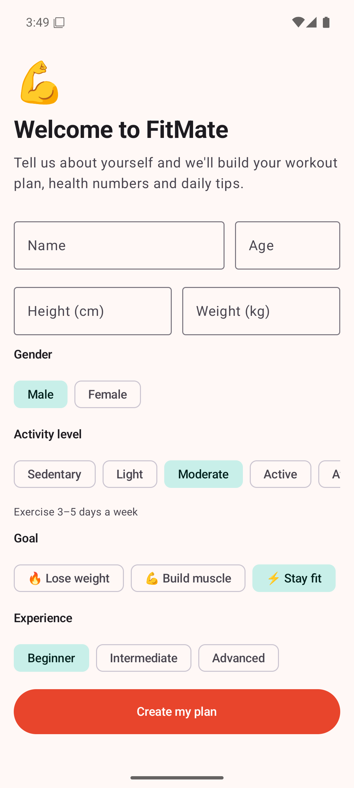
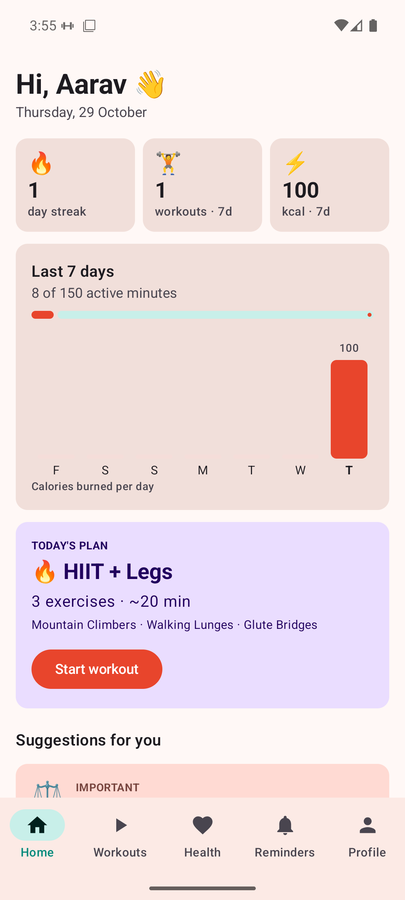
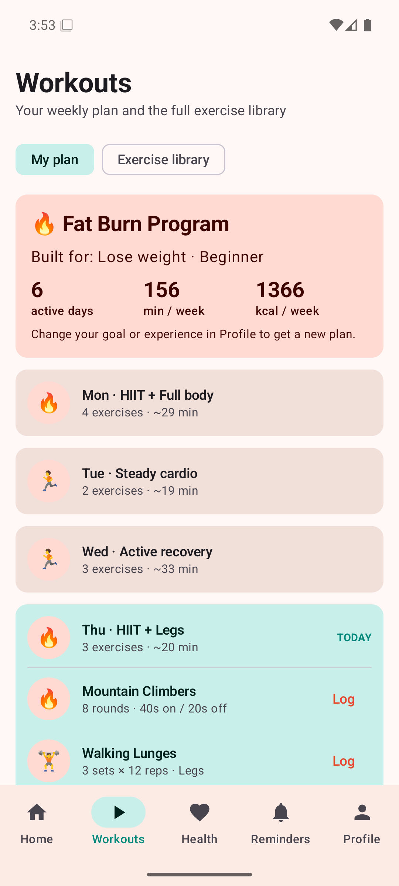
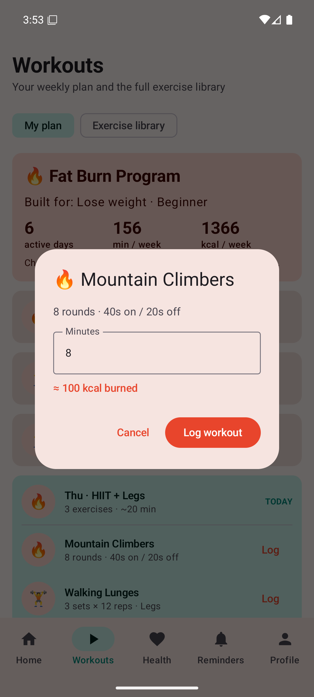
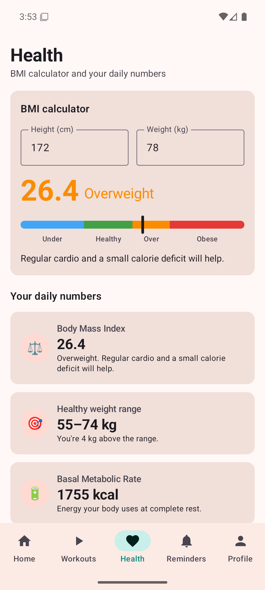
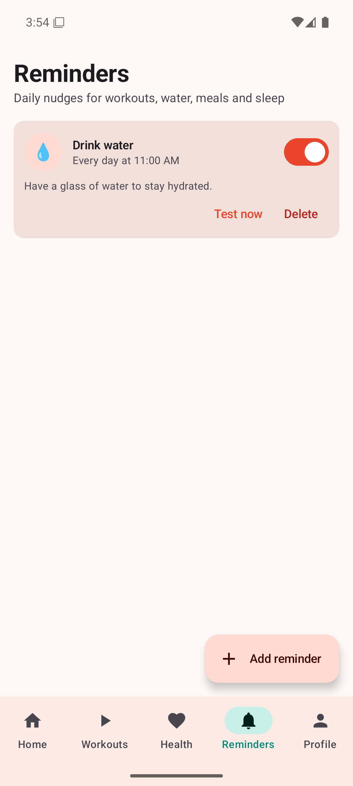
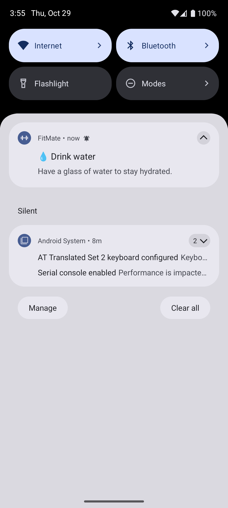

# FitMate – Fitness Tracker & Coach

**FitMate** is a fitness tracking application developed as an Object-Oriented Programming (OOP) project.

It helps users create workout plans, track their fitness progress, calculate health metrics, and receive personalised fitness suggestions.

The project demonstrates how Object-Oriented Programming concepts can be used to build a practical, real-world application.

## Platforms

| Platform | Language | UI Framework |
|---|---|---|
| Android | Kotlin | Jetpack Compose |
| iOS | Swift | SwiftUI |
| Desktop | Kotlin | Jetpack Compose |
| Backend | Python | FastAPI |

## Features

- **User Profile:** Create a profile with personal details, fitness goals, and experience level.
- **Workout Planner:** Generate a personalised 7-day workout plan.
- **Exercise Library:** Explore exercises from Strength, Cardio, HIIT, and Flexibility categories.
- **Workout Tracking:** Track completed exercises, workout history, calories burned, and progress.
- **Health Calculator:** Calculate BMI, BMR, daily calorie requirements, and other health metrics.
- **Smart Suggestions:** Get fitness suggestions based on your profile and activity.
- **Exercise Tutorials:** Find exercise demonstrations through YouTube.
- **Reminders:** Set reminders for workouts, water, meals, stretching, and sleep.

## Screenshots

| Onboarding | Home | Workouts | Log Workout |
|---|---|---|---|
|  |  |  |  |

| Health / BMI | Reminders | Notifications |
|---|---|---|
|  |  |  |

---

## Object-Oriented Programming Concepts

OOP is the main foundation of FitMate. Instead of writing the entire application in one place, the project is divided into classes, where each class has its own responsibility.

> 📘 **Full code walkthrough:** [docs/oop/OOP_CONCEPTS.md](docs/oop/OOP_CONCEPTS.md) shows every OOP concept and design pattern with the actual code, file/line references and C++ equivalents, plus the [class diagram](docs/oop/class_diagram.png).

### 1. Classes and Objects

A class acts as a blueprint, while an object is an instance of that class.

For example, `UserProfile` represents a user's fitness information, while `Exercise` represents an individual exercise.

Some important classes used in FitMate are:

- `UserProfile`
- `Exercise`
- `WorkoutPlan`
- `WorkoutSession`
- `WorkoutLog`
- `SuggestionEngine`

### 2. Encapsulation

Encapsulation means keeping data and the methods that work on that data together, while controlling how the data is accessed or modified.

**Example in FitMate:**

The `UserProfile` class manages information such as age, height, and weight. It also validates values before accepting changes.

This prevents invalid profile information from entering the application.

### 3. Inheritance

Inheritance allows one class to reuse the properties and methods of another class.

**Example in FitMate:**

Different types of exercises share common properties, so they are organised using an inheritance hierarchy.

```text
             Exercise
                 |
       ---------------------
       |         |         |
   Strength   Cardio   Flexibility
                 |
                HIIT
```

This avoids repeating common exercise-related code.

### 4. Polymorphism

Polymorphism means that different classes can provide their own implementation of a common method.

**Example in FitMate:**

Different exercise types can calculate calories burned and estimated workout duration according to their own requirements.

For example, a cardio exercise and a strength exercise can use different calculations while still being treated as an `Exercise`.

### 5. Abstraction

Abstraction means hiding unnecessary implementation details and exposing only what is required.

**Example in FitMate:**

The `HealthMetric` interface provides a common structure for different health calculations.

Classes such as `BmiMetric` and `BmrMetric` implement their own calculation logic.

The application can use these metrics without needing to know every implementation detail.

### 6. Interfaces and Generics

FitMate also uses interfaces and generics to make the code reusable.

For example:

- `PlanStrategy` provides a common structure for different workout planning strategies.
- `SuggestionRule` provides a common structure for fitness suggestion rules.
- `Repository<T>` provides a reusable way to manage stored data.

---

## Design Patterns Used

Design patterns are reusable approaches to common software design problems.

| Pattern | How It Is Used |
|---|---|
| Singleton | A single shared instance of `ExerciseLibrary`. |
| Factory | `WorkoutPlanFactory` creates workout plans. |
| Strategy | Different strategies generate plans for different fitness goals. |
| Repository | Separates data storage from the rest of the application. |
| Observer | UI updates when application data changes. |
| Dependency Injection | Dependencies are provided to classes instead of being created everywhere. |

## Class Relationships

Some important relationships in FitMate are:

- A `WorkoutPlan` contains multiple `WorkoutSession` objects.
- Each `WorkoutSession` contains exercises.
- A `UserProfile` stores the user's fitness information.
- A `SuggestionEngine` uses different suggestion rules.
- A `WorkoutPlanFactory` selects the appropriate planning strategy.

These relationships help keep the application organised and make the code easier to maintain.

---

## Technologies Used

| Technology | Purpose |
|---|---|
| Kotlin | Android and Desktop development |
| Swift | iOS development |
| Python | Backend development |
| Jetpack Compose | Android and Desktop UI |
| SwiftUI | iOS UI |
| FastAPI | Backend API |
| Gradle | Build automation |
| Git & GitHub | Version control |

## Project Structure

```text
FitMate/
│
├── android/
│   └── app/src/main/
│       └── java/com/fitmate/app/
│           ├── model/
│           ├── health/
│           ├── planner/
│           ├── suggestions/
│           ├── tracking/
│           ├── data/
│           ├── reminders/
│           ├── tutorial/
│           ├── viewmodel/
│           └── ui/
│
├── ios/
│   └── FitMate/
│       ├── Models/
│       ├── Health/
│       ├── Planner/
│       ├── Suggestions/
│       ├── Tracking/
│       ├── Data/
│       ├── Notifications/
│       ├── ViewModels/
│       └── Views/
│
├── desktop/
│   └── src/main/kotlin/com/fitmate/app/
│       ├── model/
│       ├── planner/
│       └── tutorial/
│
├── backend/
│   └── app/
│       ├── api/
│       ├── models/
│       ├── providers/
│       └── services/
│
└── docs/
    └── screenshots/
```

## How to Run

### Android

**Requirements:** Android Studio, JDK, and Android SDK.

1. Open Android Studio.
2. Select **Open** and choose the `android` folder.
3. Wait for Gradle sync to finish.
4. Start an Android emulator or connect an Android device.
5. Click **Run**.

To build the debug APK:

```bash
cd android
./gradlew assembleDebug
```

The APK will be generated at:

```text
android/app/build/outputs/apk/debug/app-debug.apk
```

To run unit tests:

```bash
cd android
./gradlew testDebugUnitTest
```

### iOS

**Requirements:** macOS and Xcode.

1. Open `ios/FitMate.xcodeproj` in Xcode.
2. Select an iPhone simulator.
3. Click **Run**.

### Desktop

**Requirements:** JDK and Gradle.

The desktop application uses Kotlin and Jetpack Compose. It also uses JCEF for embedded tutorial playback, which requires the appropriate local browser runtime.

### Backend

**Requirements:** Python 3 and pip.

```bash
cd backend
python -m venv .venv
source .venv/bin/activate
pip install -r requirements.txt
uvicorn app.main:app --reload
```

The backend runs locally at:

```text
http://127.0.0.1:8000
```

API documentation is available at:

```text
http://127.0.0.1:8000/docs
```

---

## Project Objective

The main objective of FitMate is to understand and implement Object-Oriented Programming concepts through a practical application.

By using classes, objects, inheritance, polymorphism, abstraction, encapsulation, interfaces, and design patterns, the project demonstrates how OOP can help build software that is modular, reusable, and easier to maintain.

---

**FitMate – Your Personal Fitness Companion**
