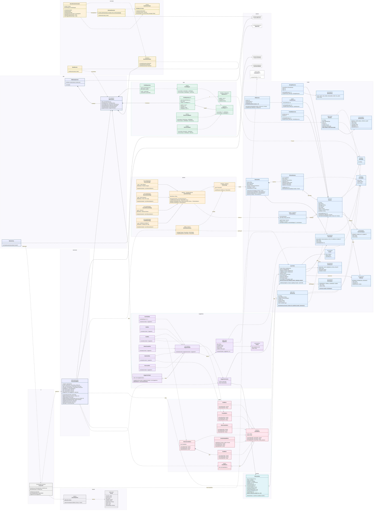

# FitMate — OOP Concepts, Code and Implementation

This document explains how each Object-Oriented Programming concept and design pattern is used in FitMate. Each section points to the real code. For every concept you get:

- **What it is**, in one or two lines
- **Where it is** (file and line numbers)
- **The code**, copied from the project. `// …` marks lines left out to keep the excerpt short.
- **How it works**, explaining what the code does at run time
- **C++ equivalent**, for comparison with a C++ OOP course

All paths are from the **Android** app (Kotlin). The desktop app reuses the same `model` and `planner` classes, and the iOS app (Swift) follows the same design.

> **Path shorthand:** `app/` means `android/app/src/main/java/com/fitmate/app/`.
> Unit tests that check these behaviours are in `android/app/src/test/java/com/fitmate/app/DomainTest.kt`.

**Class diagram:** [`class_diagram.png`](class_diagram.png) (static image) · [`class_diagram.html`](class_diagram.html) (open it in a browser to zoom in, with one tab per package)



---

## Contents

**OOP concepts**
1. [Classes and objects](#1-classes-and-objects)
2. [Encapsulation](#2-encapsulation)
3. [Abstraction](#3-abstraction)
4. [Inheritance](#4-inheritance)
5. [Polymorphism](#5-polymorphism)
6. [Interfaces](#6-interfaces)
7. [Generics](#7-generics)
8. [Composition and aggregation](#8-composition-and-aggregation)
9. [Static members (companion objects)](#9-static-members-companion-objects)
10. [Enums as classes](#10-enums-as-classes)
11. [Object contracts and immutability](#11-object-contracts-and-immutability)
12. [Validation with exceptions](#12-validation-with-exceptions)

**Design patterns**

13. [Strategy](#13-strategy)
14. [Template Method](#14-template-method)
15. [Factory](#15-factory)
16. [Factory Method](#16-factory-method)
17. [Singleton](#17-singleton)
18. [Repository](#18-repository)
19. [Dependency Injection](#19-dependency-injection)
20. [Observer](#20-observer)
21. [Rule list (open/closed principle)](#21-rule-list-openclosed-principle)

**Summary**

22. [SOLID principles in FitMate](#22-solid-principles-in-fitmate)
23. [Quick reference: Kotlin keyword → C++ equivalent](#23-quick-reference-kotlin-keyword--c-equivalent)

---

## 1. Classes and objects

**What:** A class is a blueprint, and an object is one instance of it. FitMate has about 67 classes, interfaces, enums and objects, organised into packages by responsibility:

| Package | Responsibility | Key classes |
|---|---|---|
| `model` | Domain data | `Exercise` (+4 subclasses), `UserProfile`, `WorkoutPlan`, `WorkoutSession`, `WorkoutLog`, `Reminder`, enums |
| `planner` | Builds a weekly plan | `PlanStrategy`, `BasePlanStrategy`, 4 strategies, `WorkoutPlanFactory` |
| `data` | Saves to and loads from storage | `Repository<T>`, `PrefsRepository<T>`, `JsonMapper<T>`, mappers |
| `health` | Health calculations | `HealthMetric` + 6 metrics |
| `suggestions` | Tips | `SuggestionEngine`, `SuggestionRule` + 6 rules, `Suggestion` |
| `tracking` | Weekly stats | `WorkoutStats` |
| `reminders` | Alarms and notifications | `ReminderScheduler`, `AlarmReminderScheduler`, receivers |
| `viewmodel` / `ui` | Screen state and UI | `FitnessViewModel`, Compose screens |

**Where:** `app/model/WorkoutPlan.kt` lines 39–58

```kotlin
class WorkoutPlan(
    val name: String,
    val goal: FitnessGoal,
    val level: Difficulty,
    val sessions: List<WorkoutSession>
) {
    val activeDays: Int get() = sessions.count { !it.isRestDay }
    val weeklyMinutes: Int get() = sessions.sumOf { it.totalMinutes() }
    fun weeklyCalories(weightKg: Double): Double = sessions.sumOf { it.estimatedCalories(weightKg) }
    // …
}
```

**How it works:** the brackets after the class name form the **primary constructor**. Writing `val` there declares a field and initialises it in one step. `activeDays` is a **computed property**: it has a getter and no stored field.

**C++ equivalent:**

```cpp
class WorkoutPlan {
public:
    WorkoutPlan(std::string name, FitnessGoal goal, Difficulty level, std::vector<WorkoutSession> sessions)
        : name(std::move(name)), goal(goal), level(level), sessions(std::move(sessions)) {}
    int activeDays() const;          // computed, no stored field
    const std::string name;
    // …
};
```

---

## 2. Encapsulation

**What:** keep data private and control every change to it, so an object can never end up in an invalid state.

### 2a. Validating setters — `UserProfile`

**Where:** `app/model/UserProfile.kt` lines 8–52

```kotlin
class UserProfile(
    name: String,
    age: Int,
    heightCm: Double,
    weightKg: Double,
    // …
) {
    var age: Int = 0
        set(value) {
            require(value in MIN_AGE..MAX_AGE) { "Age must be between $MIN_AGE and $MAX_AGE" }
            field = value
        }

    var weightKg: Double = 0.0
        set(value) {
            require(value in MIN_WEIGHT..MAX_WEIGHT) {
                "Weight must be between ${MIN_WEIGHT.toInt()} and ${MAX_WEIGHT.toInt()} kg"
            }
            field = value
        }

    init {
        // Route constructor values through the setters so they get validated too.
        this.name = name
        this.age = age
        this.heightCm = heightCm
        this.weightKg = weightKg
    }
```

**How it works:**
- Every assignment, such as `profile.age = 5`, goes through `set(value)`. `require(...)` throws `IllegalArgumentException` if the value is out of range.
- `field` is the hidden backing variable. Only the setter writes to it.
- The constructor parameters are not properties themselves. The `init` block passes them through the same setters, so **both construction and later updates are validated**.
- `bmi` and `bmiCategory` (lines 55–62) are read-only and are computed from height and weight, so they can never be out of sync.

**Tested by:** `impossibleWeightIsRejected()` and `setterAlsoValidates()` in `DomainTest.kt`.

### 2b. Read-only state from outside — `FitnessViewModel`

**Where:** `app/viewmodel/FitnessViewModel.kt` lines 27–55

```kotlin
class FitnessViewModel(application: Application) : AndroidViewModel(application) {
    private val container = (application as FitMateApplication).container

    var profile by mutableStateOf(container.profileRepository.load())
        private set
    var logs by mutableStateOf(loadLogs())
        private set
    // …
    fun saveProfile(newProfile: UserProfile) {
        container.profileRepository.save(newProfile)
        profile = newProfile
    }
```

**How it works:** screens can **read** `viewModel.profile` but cannot assign to it, because the setter is `private`. The only way to change it is through a method such as `saveProfile()`, which also saves the data. That guarantees storage and the UI stay in sync.

### 2c. Private helpers

`PrefsRepository.write()`, `AlarmReminderScheduler.pendingIntentFor()` and `HealthyWeightMetric.weightAt()` are `private`: they are implementation details that callers never see.

**C++ equivalent:**

```cpp
class UserProfile {
    int age_;                                   // private data
public:
    void setAge(int v) {
        if (v < MIN_AGE || v > MAX_AGE) throw std::invalid_argument("Age out of range");
        age_ = v;
    }
    int age() const { return age_; }            // public getter
};
```

---

## 3. Abstraction

**What:** expose *what* an object can do and hide *how* it does it. You can't create an abstract type directly. It only defines a contract.

**Where:** `app/model/Exercise.kt` lines 17–60

```kotlin
abstract class Exercise(
    override val id: String,
    val name: String,
    val description: String,
    val level: Difficulty,
    val met: Double,
    val videoUrl: String = ""
) : Identifiable, Describable {

    abstract val category: ExerciseCategory

    /** How long this exercise usually takes, in minutes. Each subclass works it out differently. */
    abstract fun estimatedMinutes(): Int

    /** Returns a copy tuned to an experience level. Overrides return their own subclass type. */
    abstract fun scaledFor(level: Difficulty): Exercise

    open fun caloriesBurned(weightKg: Double, minutes: Int): Double =
        met * 3.5 * weightKg / 200.0 * minutes
    // …
}
```

**How it works:**
- `Exercise(...)` on its own does not compile. Only concrete subclasses can be created.
- `abstract` members **must** be implemented by every subclass.
- `open fun caloriesBurned` has a default body that subclasses **may** override.
- Code that uses exercises, such as `WorkoutSession` or `WorkoutLog.from()`, only knows about `Exercise`. It never needs to know which subclass it has.

The project's other abstractions are the interfaces `PlanStrategy`, `HealthMetric`, `Repository<T>`, `ReminderScheduler` and `SuggestionRule` (see [§6](#6-interfaces)).

**C++ equivalent:**

```cpp
class Exercise {                                     // abstract: has pure virtual functions
public:
    virtual ~Exercise() = default;
    virtual ExerciseCategory category() const = 0;
    virtual int estimatedMinutes() const = 0;
    virtual std::unique_ptr<Exercise> scaledFor(Difficulty) const = 0;
    virtual double caloriesBurned(double kg, int min) const { return met * 3.5 * kg / 200.0 * min; }
protected:
    double met;
};
```

---

## 4. Inheritance

**What:** a subclass reuses and extends a parent class (an "is-a" relationship).

### 4a. The exercise hierarchy (multilevel inheritance)

```text
              Exercise  (abstract)
          ┌──────┼──────────────┐
 StrengthExercise  CardioExercise (open)  FlexibilityExercise
                          │
                     HiitExercise          ← multilevel: Exercise → Cardio → HIIT
```

**Where:** `app/model/Exercise.kt` lines 87–137

```kotlin
/** `open` so that [HiitExercise] can extend it. */
open class CardioExercise(
    id: String, name: String, description: String, level: Difficulty, met: Double,
    val durationMinutes: Int,
    videoUrl: String = ""
) : Exercise(id, name, description, level, met, videoUrl) {
    // …
}

/** Multi-level inheritance: Exercise → CardioExercise → HiitExercise. */
class HiitExercise(
    id: String, name: String, description: String, level: Difficulty, met: Double,
    val rounds: Int,
    val workSeconds: Int,
    val restSeconds: Int,
    videoUrl: String = ""
) : CardioExercise(
    id, name, description, level, met,
    durationMinutes = ceil(rounds * (workSeconds + restSeconds) / 60.0).toInt(),
    videoUrl = videoUrl
) {
    override fun caloriesBurned(weightKg: Double, minutes: Int): Double =
        super.caloriesBurned(weightKg, minutes) * AFTERBURN_BONUS
    // …
}
```

**How it works:**
- `: CardioExercise(...)` calls the **parent constructor**. `HiitExercise` works out `durationMinutes` from rounds and passes it up, so the parent's `estimatedMinutes()` works without changes.
- **Kotlin classes are `final` by default.** `CardioExercise` must be marked `open` before anything can inherit from it. `StrengthExercise` is not open, so nothing can extend it.
- `super.caloriesBurned(...)` reuses the parent's formula and adds a 15% "afterburn" bonus.

**Tested by:** `hiitIsACardioExerciseAndBurnsMore()`, which checks that `hiit is CardioExercise` and that HIIT burns exactly 1.15× more.

### 4b. The strategy hierarchy

`FatLossStrategy`, `MuscleGainStrategy`, `GeneralFitnessStrategy` and `FlexibilityStrategy` all extend `abstract class BasePlanStrategy` (`app/planner/PlanStrategy.kt` lines 29–117). See [§14](#14-template-method).

### 4c. Inheriting from the framework

| FitMate class | Extends | Overrides |
|---|---|---|
| `FitMateApplication` | `android.app.Application` | `onCreate()` |
| `MainActivity` | `ComponentActivity` | `onCreate()` |
| `FitnessViewModel` | `AndroidViewModel` | — |
| `ReminderReceiver`, `BootReceiver` | `BroadcastReceiver` | `onReceive()` |

**C++ equivalent:**

```cpp
class CardioExercise : public Exercise { /* … */ };
class HiitExercise final : public CardioExercise {
    double caloriesBurned(double kg, int min) const override {
        return CardioExercise::caloriesBurned(kg, min) * 1.15;   // like Kotlin's super.
    }
};
```

---

## 5. Polymorphism

### 5a. Runtime polymorphism (overriding and dynamic dispatch)

**What:** one call can run different code depending on the object's actual class at run time.

**Where:** `app/model/WorkoutPlan.kt` lines 24–28

```kotlin
fun totalMinutes(): Int = exercises.sumOf { it.estimatedMinutes() }

/** Polymorphism: each exercise is asked for calories using its *own* formula. */
fun estimatedCalories(weightKg: Double): Double =
    exercises.sumOf { it.caloriesBurned(weightKg, it.estimatedMinutes()) }
```

**How it works:** `exercises` is a `List<Exercise>`, but at run time it holds a mix of `StrengthExercise`, `CardioExercise`, `HiitExercise` and `FlexibilityExercise` objects. Each `it.estimatedMinutes()` call runs that subclass's own version:

| Class | `estimatedMinutes()` |
|---|---|
| `StrengthExercise` | `sets × reps × 4 s` plus 90 s of rest between sets |
| `CardioExercise` | `durationMinutes` |
| `HiitExercise` | inherited from Cardio (derived from rounds) |
| `FlexibilityExercise` | `holdSeconds × rounds × 2` (both sides of the body) |

The **UI** uses the same idea. `DescribableRow(item: Describable)` in `app/ui/components/Components.kt` draws an exercise, a session, a log, a reminder or a suggestion. It only reads `title`, `subtitle` and `emoji`.

### 5b. Compile-time polymorphism (overloading)

**Where:** `app/model/WorkoutPlan.kt` lines 51–57

```kotlin
fun sessionFor(day: DayOfWeek): WorkoutSession? = sessions.firstOrNull { it.day == day }

/** Day 1 is Monday, Day 7 is Sunday. */
fun sessionFor(dayNumber: Int): WorkoutSession? = sessions.firstOrNull { it.dayNumber == dayNumber }
```

There are two methods named `sessionFor`, with different parameter types. The compiler picks one based on the argument type.

**Operator overloading:** `app/model/ExerciseLibrary.kt` line 55

```kotlin
operator fun get(id: String): Exercise = byId[id] ?: error("Unknown exercise id: $id")
```

This lets callers write `ExerciseLibrary["squats"]`, the same as `operator[]` in C++.

### 5c. Covariant return types

**Where:** `app/model/Exercise.kt` lines 49, 82, 103, 132, 159

```kotlin
abstract fun scaledFor(level: Difficulty): Exercise                 // in Exercise
override fun scaledFor(level: Difficulty): StrengthExercise = …     // in StrengthExercise
override fun scaledFor(level: Difficulty): HiitExercise = …         // in HiitExercise
```

An override may return a **more specific** type than the parent declares. Calling `scaledFor` on a `StrengthExercise` gives back a `StrengthExercise` directly, with no cast needed.

**Tested by:** `scaledForKeepsTheSubclassAndAddsVolume()`.

**C++ equivalent:** `virtual` + `override` gives runtime polymorphism. Function overloading and `operator[]` work as in Kotlin. C++ also allows covariant return types for raw pointers and references, as in `StrengthExercise* scaledFor(...) const override;`.

---

## 6. Interfaces

**What:** a pure contract with no state. A class can implement **many** interfaces.

### 6a. Implementing more than one interface

**Where:** `app/model/Interfaces.kt` lines 4–17

```kotlin
interface Identifiable {
    val id: String
}

interface Describable {
    val title: String
    val subtitle: String
    val emoji: String
}
```

| Class | `Identifiable` | `Describable` | Other |
|---|:-:|:-:|---|
| `Exercise` | ✓ | ✓ | |
| `WorkoutLog` | ✓ | ✓ | |
| `Reminder` | ✓ | ✓ | |
| `WorkoutSession` | | ✓ | |
| `Suggestion` | | ✓ | `Comparable<Suggestion>` |

`Identifiable` is what lets objects be stored in a `Repository` (see [§7](#7-generics)). `Describable` is what lets them be shown in the UI ([§5a](#5a-runtime-polymorphism-overriding-and-dynamic-dispatch)).

### 6b. An interface with a default method

**Where:** `app/health/HealthMetric.kt` lines 15–25

```kotlin
interface HealthMetric {
    val name: String
    val emoji: String
    fun calculate(profile: UserProfile): Double
    fun interpret(profile: UserProfile): String
    fun formatted(profile: UserProfile): String = String.format(Locale.US, "%.1f", calculate(profile))
}
```

`formatted()` has a body. `BmiMetric` inherits it unchanged, while `BmrMetric` overrides it to show `"1650 kcal"` instead.

### 6c. A functional interface

**Where:** `app/suggestions/SuggestionRules.kt` lines 16–18

```kotlin
fun interface SuggestionRule {
    fun evaluate(context: SuggestionContext): Suggestion?
}
```

A `fun interface` has exactly one abstract method, so a lambda can implement it. `SuggestionEngine.defaultRules()` does exactly that for its "warm up longer if age ≥ 40" rule.

### 6d. Programming to an interface

`AppContainer` declares `val reminderScheduler: ReminderScheduler = AlarmReminderScheduler(context)`. The rest of the app only sees the interface, so the Android-specific `AlarmManager` code stays inside one class.

**C++ equivalent:** an interface is a class with only pure virtual functions, and implementing several is multiple inheritance: `class Exercise : public Identifiable, public Describable`. A default method is a virtual function with a body. A `fun interface` is close to a `std::function<std::optional<Suggestion>(const SuggestionContext&)>`.

---

## 7. Generics

**What:** write a class or function once and use it with many types, with type safety checked at compile time.

### 7a. A generic interface with a bound

**Where:** `app/data/Repository.kt` lines 11–58

```kotlin
interface Repository<T : Identifiable> {
    fun getAll(): List<T>
    fun save(item: T)
    fun delete(id: String)
}

interface JsonMapper<T> {
    fun toJson(item: T): JSONObject
    fun fromJson(json: JSONObject): T
}

class PrefsRepository<T : Identifiable>(
    private val prefs: SharedPreferences,
    private val key: String,
    private val mapper: JsonMapper<T>
) : Repository<T> {

    override fun save(item: T) {
        val items = getAll().toMutableList()
        val index = items.indexOfFirst { it.id == item.id }   // allowed because T : Identifiable
        if (index >= 0) items[index] = item else items.add(item)
        write(items)
    }
    // …
}
```

**How it works:**
- `T : Identifiable` is an **upper bound**: `T` can be any type that has an `id`. That's why `save()` can use `item.id`.
- `PrefsRepository` is written **once** and used twice in `AppContainer`, as `Repository<WorkoutLog>` and as `Repository<Reminder>` (`app/FitMateApplication.kt` lines 25–26).
- The type-specific part, turning an object into JSON, is handed to the injected `JsonMapper<T>`.

### 7b. A generic function with a reified type

**Where:** `app/model/ExerciseLibrary.kt` line 61

```kotlin
inline fun <reified T : Exercise> ofType(): List<T> = all.filterIsInstance<T>()
```

`ExerciseLibrary.ofType<CardioExercise>()` returns every cardio exercise **including HIIT**, because a `HiitExercise` *is a* `CardioExercise`. `FlexibilityStrategy` uses `ofType<FlexibilityExercise>()` to build its "Full Stretch Day".

**Tested by:** `ofTypeUsesTheClassHierarchy()`.

**C++ equivalent:**

```cpp
template <typename T> requires std::derived_from<T, Identifiable>   // C++20 concept = Kotlin bound
class PrefsRepository : public Repository<T> { /* … */ };

template <typename T>
std::vector<T*> ofType() {                    // filterIsInstance ≈ dynamic_cast filter
    std::vector<T*> out;
    for (auto& e : all) if (auto p = dynamic_cast<T*>(e.get())) out.push_back(p);
    return out;
}
```

---

## 8. Composition and aggregation

**What:** a "has-a" relationship. **Composition** means the whole owns its parts, which are created with it and live and die with it. **Aggregation** means the whole only refers to parts that exist independently.

| Relationship | Kind | Where |
|---|---|---|
| `WorkoutPlan` **has** 7 `WorkoutSession`s | Composition ◆ | `app/model/WorkoutPlan.kt` line 43 |
| `WorkoutSession` **refers to** `Exercise`s | Aggregation ◇ (the exercises are shared from `ExerciseLibrary`) | `app/model/WorkoutPlan.kt` line 11 |
| `DailyCaloriesMetric` **has a** `BmrMetric` | Composition ◆ | `app/health/HealthMetric.kt` line 51 |
| `AppContainer` **creates and owns** repositories, scheduler and engine | Composition ◆ | `app/FitMateApplication.kt` lines 21–29 |
| `SuggestionEngine` **has** a list of rules | Aggregation ◇ (rules are passed in) | `app/suggestions/SuggestionEngine.kt` line 8 |

**Composition used instead of inheritance:**

```kotlin
class DailyCaloriesMetric(private val bmr: BmrMetric = BmrMetric()) : HealthMetric {
    override fun calculate(profile: UserProfile): Double =
        bmr.calculate(profile) * profile.activityLevel.multiplier + profile.goal.calorieAdjustment
    // …
}
```

`DailyCaloriesMetric` *uses* a `BmrMetric` rather than *being* one. A daily calorie target is not a kind of BMR, so inheriting from it would be wrong.

**C++ equivalent:** composition is a member object (`BmrMetric bmr;`) or a `std::unique_ptr`. Aggregation is a raw pointer, a reference or a `std::shared_ptr` to an object owned somewhere else, such as `std::vector<const Exercise*>` pointing into the library.

---

## 9. Static members (companion objects)

**What:** members that belong to the class itself rather than to an object. Kotlin has no `static` keyword and uses a `companion object` instead.

```kotlin
// app/model/UserProfile.kt lines 68–75 — static constants
companion object {
    const val MIN_AGE = 10
    const val MAX_AGE = 100
    // …
}

// app/model/Exercise.kt lines 135–137 — private static constant
companion object {
    private const val AFTERBURN_BONUS = 1.15
}

// app/tracking/WorkoutStats.kt — public static constant used by SuggestionRules
companion object {
    const val WEEKLY_MINUTES_TARGET = 150
}
```

These are used as `UserProfile.MIN_AGE` or `WorkoutStats.WEEKLY_MINUTES_TARGET`, without creating an object. Static **functions** are covered in [§16](#16-factory-method).

**C++ equivalent:** `static constexpr int MIN_AGE = 10;` and `static WorkoutLog from(...);`.

---

## 10. Enums as classes

**What:** Kotlin enums are full classes. Each constant can carry data, and the enum can have methods and a companion object.

**Where:** `app/model/Enums.kt` lines 51–66

```kotlin
enum class BmiCategory(val label: String, val advice: String) {
    UNDERWEIGHT("Underweight", "Focus on nutrient-dense meals and strength training."),
    NORMAL("Healthy", "Great work — keep up a balanced routine."),
    OVERWEIGHT("Overweight", "Regular cardio and a small calorie deficit will help."),
    OBESE("Obese", "Start with low-impact cardio and consider a doctor's advice.");

    companion object {
        fun from(bmi: Double): BmiCategory = when {
            bmi < 18.5 -> UNDERWEIGHT
            bmi < 25.0 -> NORMAL
            bmi < 30.0 -> OVERWEIGHT
            else -> OBESE
        }
    }
}
```

The enums' data drives the calculations directly. `Difficulty.extraSets` and `durationFactor` scale exercises, `FitnessGoal.calorieAdjustment` is the −500/+300 kcal adjustment, and `ActivityLevel.multiplier` is the TDEE factor. Enums are also `Comparable` by declaration order: `WaterIntakeMetric` checks `activityLevel >= ActivityLevel.ACTIVE`.

**C++ equivalent:** an `enum class` can't hold data. You'd need a lookup table or a class with `static const` instances.

---

## 11. Object contracts and immutability

### 11a. `data class` — generated equals, hashCode, toString and copy

**Where:** `app/model/WorkoutLog.kt` line 11, `app/model/Reminder.kt` line 22, `app/suggestions/Suggestion.kt` line 15

```kotlin
data class Reminder(
    override val id: String = UUID.randomUUID().toString(),
    val type: ReminderType,
    val hour: Int,
    val minute: Int,
    val enabled: Boolean = true
) : Identifiable, Describable { /* … */ }
```

The compiler generates `equals()` (compares by value), a matching `hashCode()`, a readable `toString()` and `copy()`.

### 11b. Immutability with `copy()`

Every field is a `val`, so a `Reminder` can't be changed after it is created. To toggle one, `FitnessViewModel` makes a modified copy (`app/viewmodel/FitnessViewModel.kt` line 74):

```kotlin
val updated = reminder.copy(enabled = enabled)
```

### 11c. Ordering — `Comparable`

**Where:** `app/suggestions/Suggestion.kt` lines 15–25

```kotlin
data class Suggestion(
    override val title: String,
    val message: String,
    val priority: Priority,
    override val emoji: String
) : Describable, Comparable<Suggestion> {
    override val subtitle: String get() = message
    override fun compareTo(other: Suggestion): Int = priority.compareTo(other.priority)
}
```

Because of this, `rules.mapNotNull { … }.sorted()` in `SuggestionEngine` puts HIGH-priority tips first without needing a separate comparator.

**C++ equivalent:** `bool operator==(const Reminder&) const = default;`, a `std::hash<Reminder>` specialisation, `operator<<` for printing, `const` members for immutability, and `operator<` (or `<=>`) for ordering.

---

## 12. Validation with exceptions

`require(...)` in `UserProfile` and `Reminder` throws `IllegalArgumentException`. The storage layer catches it, so corrupted saved data can't crash the app.

**Where:** `app/data/Mappers.kt` lines 80–96

```kotlin
fun load(): UserProfile? {
    val raw = prefs.getString(KEY, null) ?: return null
    return try {
        ProfileMapper.fromJson(JSONObject(raw))
    } catch (e: JSONException) {
        null
    } catch (e: IllegalArgumentException) {   // thrown by UserProfile's validating setters
        null
    }
}
```

**C++ equivalent:** `throw std::invalid_argument(...)` together with `try { … } catch (const std::invalid_argument&) { … }`.

---

## 13. Strategy

**Problem:** each fitness goal needs a completely different weekly plan. Putting all of them in one `if/else` would make that code very long, and every new goal would mean editing it.

**Solution:** one class per goal, each behind the same interface.

**Where:** `app/planner/PlanStrategy.kt` lines 20–23

```kotlin
/** STRATEGY pattern: each fitness goal has its own algorithm for building a week. */
interface PlanStrategy {
    val goal: FitnessGoal
    fun buildPlan(level: Difficulty): WorkoutPlan
}
```

| Goal | Strategy class | Plan name |
|---|---|---|
| `LOSE_WEIGHT` | `FatLossStrategy` | Fat Burn Program |
| `BUILD_MUSCLE` | `MuscleGainStrategy` | Push / Pull / Legs |
| `STAY_FIT` | `GeneralFitnessStrategy` | Balanced Fitness |
| `IMPROVE_FLEXIBILITY` | `FlexibilityStrategy` | Mobility & Yoga |

**Benefit:** to change the muscle plan you edit only `MuscleGainStrategy`. To add a goal you add one class and one line in the factory.

---

## 14. Template Method

**Problem:** every strategy builds its plan with the same steps: get the week, scale each exercise to the user's level, then wrap it in a `WorkoutPlan`. Only the list of days differs between goals.

**Where:** `app/planner/PlanStrategy.kt` lines 29–68

```kotlin
abstract class BasePlanStrategy : PlanStrategy {

    protected abstract val planName: String
    protected abstract fun weeklySchedule(): List<WorkoutSession>

    final override fun buildPlan(level: Difficulty): WorkoutPlan {           // ← the template
        val sessions = weeklySchedule().mapIndexed { index, session ->        // step 1: subclass hook
            WorkoutSession(
                session.day, session.focus,
                session.exercises.map { it.scaledFor(level) },                // step 2: polymorphic scaling
                dayNumber = index + 1
            )
        }
        return WorkoutPlan(planName, goal, level, sessions)                   // step 3: wrap
    }

    protected fun day(day: DayOfWeek, focus: String, vararg exerciseIds: String) =
        WorkoutSession(day, focus, exerciseIds.map { ExerciseLibrary[it] })
    protected fun rest(day: DayOfWeek) = WorkoutSession(day, "Rest & recover", emptyList())
}

class FatLossStrategy : BasePlanStrategy() {
    override val goal = FitnessGoal.LOSE_WEIGHT
    override val planName = "Fat Burn Program"

    override fun weeklySchedule() = listOf(
        day(MONDAY, "Full-Body HIIT Day", "burpees", "squats", "pushups", "crunches"),
        day(TUESDAY, "Cardio Day", "running", "crunches", "hamstring_stretch"),
        // …
        rest(SUNDAY)
    )
}
```

**How it works:**
- `final override fun buildPlan` sets the order of steps, and **subclasses can't change it**.
- Subclasses fill in only the `protected abstract` hooks: `weeklySchedule()` and `planName`.
- `day()` and `rest()` are `protected` helpers. Subclasses can use them, but outside code can't see them.
- `vararg exerciseIds` is a variable-length argument list, similar to a C++ variadic template or an `initializer_list`.

**Tested by:** `everyGoalGetsASevenDayPlan()` and `planIsNumberedDay1ToDay7WithClearDayNames()`.

**C++ equivalent:** a public **non-virtual** `buildPlan()` that calls `protected` pure virtual hooks. This is the "Non-Virtual Interface" (NVI) idiom.

---

## 15. Factory

**Problem:** the ViewModel needs a plan but shouldn't have to know which strategy class to create.

**Where:** `app/planner/PlanStrategy.kt` lines 120–131

```kotlin
/** FACTORY pattern: callers ask for a plan and never need to know which strategy class built it. */
object WorkoutPlanFactory {

    fun strategyFor(goal: FitnessGoal): PlanStrategy = when (goal) {
        FitnessGoal.LOSE_WEIGHT -> FatLossStrategy()
        FitnessGoal.BUILD_MUSCLE -> MuscleGainStrategy()
        FitnessGoal.STAY_FIT -> GeneralFitnessStrategy()
        FitnessGoal.IMPROVE_FLEXIBILITY -> FlexibilityStrategy()
    }

    fun createPlan(profile: UserProfile): WorkoutPlan =
        strategyFor(profile.goal).buildPlan(profile.experience)
}
```

**How it works:** `strategyFor` returns the interface type `PlanStrategy`. The `when` must cover every enum value, so adding a new `FitnessGoal` without a strategy is a **compile error** rather than a crash at run time. The single caller is `FitnessViewModel.plan` (line 45): `profile?.let { WorkoutPlanFactory.createPlan(it) }`.

**Full flow:**

```text
FitnessViewModel.plan
  └─ WorkoutPlanFactory.createPlan(profile)
       ├─ strategyFor(profile.goal)          → e.g. MuscleGainStrategy        (Factory)
       └─ .buildPlan(profile.experience)     → BasePlanStrategy.buildPlan     (Template Method)
            ├─ weeklySchedule()              → MuscleGainStrategy's 7 days    (Strategy)
            └─ exercise.scaledFor(level)     → each subclass's own scaling    (Polymorphism)
  → WorkoutPlan (7 WorkoutSessions)
```

**Tested by:** `factoryPicksTheStrategyForTheGoal()`.

---

## 16. Factory Method

Static methods that create the right object from some input:

```kotlin
// app/model/WorkoutLog.kt lines 31–37 — builds a log from ANY Exercise subclass
fun from(exercise: Exercise, minutes: Int, weightKg: Double) = WorkoutLog(
    exerciseName = exercise.name,
    category = exercise.category,
    minutes = minutes,
    calories = exercise.caloriesBurned(weightKg, minutes)   // polymorphic: HIIT gets its bonus
)

// app/model/Enums.kt line 59 — picks the right enum constant
fun from(bmi: Double): BmiCategory = when { /* … */ }
```

---

## 17. Singleton

**What:** exactly one shared instance for the whole app. In Kotlin, the `object` keyword declares a class and creates its single instance, and that initialisation is thread-safe.

**Where:** `app/model/ExerciseLibrary.kt` lines 17–65

```kotlin
object ExerciseLibrary {
    val all: List<Exercise> = listOf(
        StrengthExercise("pushups", "Push-ups", "…", BEGINNER, 3.8, MuscleGroup.CHEST, sets = 3, reps = 12),
        // … 23 exercises in total
    )
    private val byId: Map<String, Exercise> = all.associateBy { it.id }
    operator fun get(id: String): Exercise = byId[id] ?: error("Unknown exercise id: $id")
    // …
}
```

Other `object`s in the code are `WorkoutPlanFactory`, `HealthMetrics`, `NotificationHelper`, `TutorialApiClient` and the three JSON mappers.

**C++ equivalent (Meyers singleton):**

```cpp
class ExerciseLibrary {
public:
    static ExerciseLibrary& instance() { static ExerciseLibrary lib; return lib; }   // thread-safe since C++11
    ExerciseLibrary(const ExerciseLibrary&) = delete;
    ExerciseLibrary& operator=(const ExerciseLibrary&) = delete;
private:
    ExerciseLibrary();   // fills the 23 exercises
};
```

---

## 18. Repository

**Problem:** if screens read and write `SharedPreferences` directly, storage code ends up spread across the app.

**Solution:** one interface (`Repository<T>`) with `getAll`, `save` and `delete`, and one implementation (`PrefsRepository<T>`) that stores a JSON array. If storage moved to a database (Room, say), only that class would change. The code is shown in [§7a](#7a-a-generic-interface-with-a-bound).

---

## 19. Dependency Injection

**What:** objects receive their dependencies from outside instead of creating them. FitMate does this by hand, with a container.

**Where:** `app/FitMateApplication.kt` lines 21–41

```kotlin
class AppContainer(context: Context) {
    private val prefs = context.getSharedPreferences("fitmate", Context.MODE_PRIVATE)

    val profileRepository = ProfileRepository(prefs)
    val workoutRepository: Repository<WorkoutLog> = PrefsRepository(prefs, "workout_logs", WorkoutLogMapper)
    val reminderRepository: Repository<Reminder> = PrefsRepository(prefs, "reminders", ReminderMapper)
    val reminderScheduler: ReminderScheduler = AlarmReminderScheduler(context)
    val suggestionEngine = SuggestionEngine()
}

class FitMateApplication : Application() {
    lateinit var container: AppContainer
        private set

    override fun onCreate() {
        super.onCreate()
        container = AppContainer(this)
        // …
    }
}
```

**How it works:**
- Every shared object is created **once**, in one place.
- The fields are typed as **interfaces** (`Repository<WorkoutLog>`, `ReminderScheduler`). Swapping `AlarmReminderScheduler` for a fake in tests means changing one line.
- **Constructor injection** is also used: `PrefsRepository` gets its `JsonMapper`, `SuggestionEngine` gets its `rules`, and `DailyCaloriesMetric` gets its `BmrMetric`.

---

## 20. Observer

**What:** when data changes, everything that depends on it updates automatically.

**Where:** `app/viewmodel/FitnessViewModel.kt` lines 31–48

```kotlin
var profile by mutableStateOf(container.profileRepository.load())
    private set
var logs by mutableStateOf(loadLogs())
    private set

// Derived state: recomputed from profile/logs whenever they change.
val stats: WorkoutStats get() = WorkoutStats(logs)
val plan: WorkoutPlan? get() = profile?.let { WorkoutPlanFactory.createPlan(it) }
```

**How it works:** `mutableStateOf` is an observable holder from Jetpack Compose. Every screen that **reads** `viewModel.profile` is registered as an observer automatically. When `saveProfile()` assigns a new value, Compose redraws only those screens. Because `plan` and `stats` are computed from the observed state, changing your goal rebuilds the plan on the Home and Workouts screens with no extra code.

---

## 21. Rule list (open/closed principle)

**Problem:** the app gives tips based on many independent conditions, such as inactivity, BMI, goal, weekly minutes, recovery and hydration.

**Where:** `app/suggestions/SuggestionEngine.kt` lines 8–11

```kotlin
class SuggestionEngine(private val rules: List<SuggestionRule> = defaultRules()) {
    fun suggestionsFor(context: SuggestionContext): List<Suggestion> =
        rules.mapNotNull { it.evaluate(context) }.sorted()
}
```

**How it works:** each rule is its own class that returns a `Suggestion` or `null`. The engine asks every rule, drops the `null`s, and sorts the rest by priority using `Comparable` ([§11c](#11c-ordering--comparable)). Adding a rule never changes the engine: it is **open for extension and closed for modification**.

**Tested by:** `newUserIsNudgedToLogFirstWorkoutAndSuggestionsAreSorted()`.

---

## 22. SOLID principles in FitMate

| Principle | Where it shows |
|---|---|
| **S**ingle responsibility | `JsonMapper`s only convert to and from JSON. `Repository` only stores. `WorkoutStats` only calculates stats. |
| **O**pen/closed | New goal → a new `PlanStrategy`. New tip → a new `SuggestionRule`. New metric → a new `HealthMetric`. Existing code doesn't change. |
| **L**iskov substitution | Any `Exercise` subclass works wherever an `Exercise` is expected, for example in `WorkoutSession`, `WorkoutLog.from()` or `DescribableRow`. |
| **I**nterface segregation | `Identifiable` (only an id) and `Describable` (only display fields) are small and separate, so a type implements only what it needs. |
| **D**ependency inversion | The ViewModel depends on the `Repository` and `ReminderScheduler` interfaces, not on SharedPreferences or AlarmManager. |

---

## 23. Quick reference: Kotlin keyword → C++ equivalent

| Kotlin in FitMate | Meaning | C++ |
|---|---|---|
| `class A(val x: Int)` | Primary constructor that also declares a field | Constructor with a member initialiser list |
| `init { … }` | Code run as part of the constructor | Constructor body |
| `abstract class` / `abstract fun` | Can't be instantiated / must be overridden | Class with a pure virtual `= 0` function |
| `open class` / `open fun` | May be inherited from / may be overridden | Non-`final` class / `virtual` function |
| (default) | Classes and methods are final | `final` |
| `override` | Overrides a parent member | `override` |
| `super.f()` | Calls the parent's version | `Base::f()` |
| `interface` | Pure contract (may have default methods) | Abstract class with only pure virtual functions |
| `: A(), B, C` | Extends one class and implements interfaces | `: public A, public B, public C` |
| `private` / `protected` / `public` | Visibility | Same |
| `private set` | Public getter, private setter | Public getter + private setter |
| `companion object` | Static members | `static` |
| `object X` | Singleton | Meyers singleton |
| `data class` | Generated `equals`, `hashCode`, `toString`, `copy` | `operator== = default`, `std::hash`, `operator<<`, copy constructor |
| `val` | Read-only reference | `const` member / `const T&` |
| `<T : Identifiable>` | Bounded generic | Template + C++20 concept |
| `is` / `as` | Type check / cast | `dynamic_cast` |
| `operator fun get` | `x[i]` | `operator[]` |
| `vararg` | Variable number of arguments | Variadic template / `std::initializer_list` |
| `require(cond)` | Throws `IllegalArgumentException` | `throw std::invalid_argument` |
